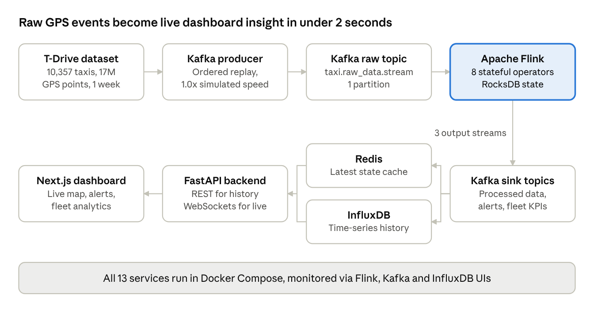

# Taxi Dashboard — Project Overview

## Executive summary

I delivered an end-to-end, real-time fleet intelligence platform that monitors 10,357 taxis live and cut average event latency by 95%, from 30–45 seconds to under 2 seconds.

The platform replays the Microsoft Research [T-Drive trajectory dataset](https://www.microsoft.com/en-us/research/publication/t-drive-trajectory-data-sample/): one week of GPS traces, about 17 million data points and 9 million km of driving across Beijing. It turns that raw stream into live positions, speed and distance analytics, geofence and speed-violation alerts, and fleet-wide KPIs, all surfaced on an interactive operations dashboard.

**Headline outcomes**

- **95% latency reduction:** average processing time per event fell from 30–45 s to under 2 s.
- **3x scale headroom:** stable performance went from about 3,000 to over 9,000 concurrent taxis.
- **Backpressure eliminated:** pipeline stalls and growing consumer lag were removed at the source.
- **Production-grade resilience:** 1-second incremental checkpointing on RocksDB, averaging 593 ms per checkpoint.
- **One-command deployment:** 13 containerised services brought up with a single script.

## Solution architecture

I designed an event-driven architecture that decouples ingestion, processing, storage and presentation, so each layer scales on its own.

Events run left to right through ingestion and Flink, then back through storage and the API to the dashboard. Two dedicated Kafka consumers write the sink topics to Redis and InfluxDB.

## Technology stack

Each layer uses an industry-standard, open-source component chosen for low latency and horizontal scalability.

| Layer | Technology | Role in the platform |
| --- | --- | --- |
| Data source | T-Drive dataset, Python, pandas, PyArrow | Pre-processed 17M GPS points into a single replayable file |
| Ingestion | Apache Kafka 4.0, aiokafka | Durable event backbone; one raw topic, three processed sink topics |
| Stream processing | Apache Flink 1.18 (PyFlink DataStream API) | Eight custom stateful operators for enrichment, aggregation and alerting |
| State and fault tolerance | RocksDB state backend, incremental checkpoints | Disk-backed keyed state for 10,000+ taxis with sub-second checkpoints |
| Serialisation | orjson, typed PyFlink Row schemas | Fast JSON handling at the edges, structured rows inside the pipeline |
| Hot cache | Redis 8 | Latest position, alerts and fleet KPIs for instant dashboard reads |
| Time-series analytics | InfluxDB 2.7 | Historical trends for speed, incidents, latency and fleet metrics |
| Backend API | FastAPI, Uvicorn, WebSockets | REST endpoints for history, WebSocket channels for live push |
| Frontend | Next.js 15, React 19, TypeScript, Tailwind CSS 4, shadcn/ui | Responsive operations dashboard |
| Mapping and charts | Leaflet, marker clustering, Recharts | Live map of thousands of taxis and analytics charts |
| Client state | Zustand | Lightweight stores fed by WebSocket and REST hooks |
| Platform and DevOps | Docker, Docker Compose, Bash deploy/cleanup scripts | One-command, reproducible deployment of the full stack |
| Observability | Flink Web UI, Kafka UI, InfluxDB UI, Prometheus config | Operator health, backpressure, consumer lag and checkpoint monitoring |
| Benchmarking | Custom Python latency and throughput tool | P50/P95/P99 latency and throughput measured over 300,000 messages |

## Methodology: what I built and how

I delivered the platform in six workstreams, moving from data foundations to a measured, production-ready system.

1. **Data engineering and controlled replay.** I built a custom data reader that consolidates the T-Drive trajectory files into one optimised file. A Kafka producer replays it in timestamp order at configurable speed (simulated mode, 1.0x), enriching every record with a `trip_status` field and emitting an explicit end-of-trip signal per taxi.
2. **Real-time stream processing.** I designed a PyFlink DataStream job with eight custom operators, chained for minimal hand-off cost:
    1. Deduplicate same-timestamp records per taxi
    2. Propagate each taxi's latest location every 5 seconds
    3. Calculate instantaneous speed (haversine formula; above 300 km/h flagged invalid)
    4. Calculate running average speed per trip
    5. Calculate cumulative distance travelled
    6. Aggregate fleet KPIs: active, in-transit and trip-ended taxis, total distance
    7. Raise geofence alerts beyond 10 km of the Forbidden City, hide taxis beyond 15 km
    8. Raise speed alerts above 50 km/h
3. **Event-time correctness.** Because ingestion is strictly ordered, I adopted a monotonic-timestamp watermark strategy with source-idleness handling. This removed out-of-order buffering and lowered latency without sacrificing correctness.
4. **Dual-tier storage.** Dedicated Kafka consumers fan processed data out to Redis for sub-millisecond "latest state" reads and to InfluxDB for time-series history. State-cleanup logic retires taxis whose trips end, keeping state bounded.
5. **API and real-time dashboard.** A FastAPI service exposes REST endpoints for history and analytics plus WebSocket channels for live taxi positions, fleet metrics and incident alerts. The Next.js dashboard renders a clustered Leaflet map, per-taxi drill-downs, fleet analytics, trend charts and a live incident feed.
6. **Containerisation and operations.** I packaged every component as a Docker image and orchestrated all 13 services with Docker Compose. Health checks, init containers for topic creation and job submission, and `deploy.sh` / `cleanup.sh` scripts make the platform reproducible on any machine.

## Performance engineering

A structured, measure-first optimisation programme took the pipeline from 30–45 s average latency to under 2 s on deliberately minimal resources (one Kafka partition, Flink parallelism of 1).

| Lever | Before | After | Business effect |
| --- | --- | --- | --- |
| Location operator design | Event timers per record | Timestamp-driven emission in keyed state | Removed timer build-up, the main source of backpressure |
| State backend | In-memory HashMap | Embedded RocksDB, 512 MB block cache | Stable memory under 10,000+ keys, no GC stalls |
| Checkpointing | Full snapshot every 60 s, exactly-once | Incremental every 1 s, at-least-once | Faster recovery, non-blocking, 593 ms average |
| TaskManager memory | 1,728 MB, 1 GB network buffers | 4,096 MB, 50% managed, 64–128 MB network | Memory moved from idle buffers to state |
| Serialisation | Pickled bytes in every operator | orjson at source and sink only, typed rows inside | Lower CPU and GC load per event |
| Watermarks | 5 s out-of-order bound | Monotonic timestamps | No waiting on late events |

**Validated results.** I built a custom benchmarking tool that measures end-to-end latency (producer send time to sink time) across 300,000 messages:

- 95% of messages processed in under 2 s, at every load level up to 10,357 taxis.
- P99 latency stayed at or below 3 s, even in the 9,000+ taxi stress zone.
- Zero backpressure across all operators over a one-hour sustained run.
- At 3x replay speed (about 120 msgs/s) the system saturated gracefully and recovered, defining the next scaling step.

Full details are in the [pipeline optimisation report](docs/FLINK_PIPELINE_OPTIMIZATION_REPORT.md).

## Business value and roadmap

The platform gives fleet operators a live, trustworthy picture of 10,000+ vehicles, with alerts arriving within about 2 seconds of the event.

- **Operational awareness:** live positions, trip status and fleet KPIs on one screen.
- **Risk and compliance:** automated speed and geofence alerts with a full incident history.
- **Data-driven decisions:** per-taxi and fleet-wide trends for speed, incidents and latency.
- **Cost efficiency:** sub-2 s performance achieved on a single partition and a 4-core, 16 GB host.

**Next steps to reach 200–300 msgs/s at the same latency**

- Scale out with more TaskManagers (8 GB each) and multi-partition Kafka topics.
- Tune per-operator parallelism and task-slot allocation.
- Adopt Flink elastic scaling driven by ingestion rate.
- Isolate high-load services on dedicated VMs with SSD-backed checkpoints.
